# DESIGN.md: Ex8:Surveillance — Detailed Design Document

## 1. Scope & Context

**Owns**

- Detection alerts (`surveillance.surveillance_alert`) — one row per
  detection: pattern (CHECK-constrained to the eight pattern keys),
  instrument, account, confidence (0–100), evidence JSONB.
- Case management (`surveillance.surveillance_case`) — the compliance
  workflow per alert: `open / investigating / closed`, dismissal flag,
  assignee, open/close timestamps, FK to the alert.
- Operational alerts (`surveillance.alert`) — the unacknowledged ops-alert
  queue (`admin_id IS NULL` = unacked; partial index for the ack sweep).
- The pure detection core: the eight `Pattern`s with severity ranking, the
  `Observation` contract, the wash-trade / spoofing / marking-the-close
  detectors, and the `CaseManager` workflow.
- Audit journaling and the outbox producer for all of the above.

**Does NOT own (delegates)**

- Regulatory reports — Ex8:Regulatory consumes closed cases; this service
  only produces the detection + workflow record.
- Where the trade/order observations come from — Ex8:ME / Ex8:Clearing /
  Ex8:Gateway / Ex8:OMS produce the event stream; Sentin8:Bus delivers it.
- Tenant-authored detection modules (layering, momentum ignition, insider,
  front-running, excessive crossing when tenant-authored) — Sentin8:Func
  executes them; this service defines only the `Pattern`/`Alert` contract.
- Identity, tokens, M2M client registration — Sentin8:Auth.
- Trigger scheduling — Sentin8:Cron (none declared by this service today).

### System context

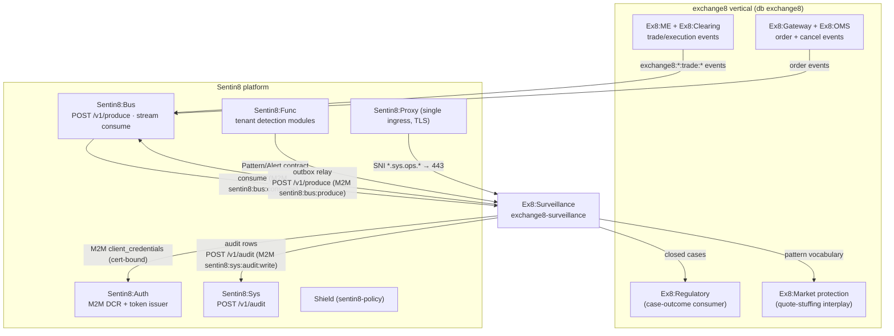

### Container view

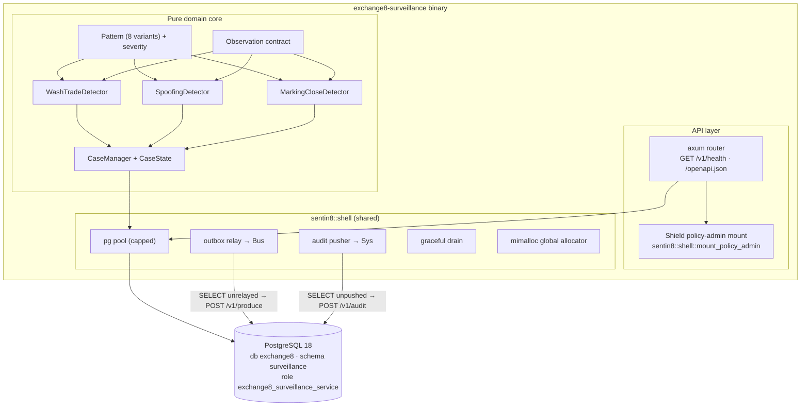

## 2. Runtime Architecture

The binary (`src/main.rs`) is a Sentin8 Shell assembly:
`Sentin8Shell::new("exchange8:surveillance", "EXCHANGE8_SURVEILLANCE")` with
registration printing, `with_simple_state()`, and `with_router(extend_router)`
that mounts the policy-admin API. The global allocator is mimalloc
(`#[global_allocator]`), covering all in-process tokio workers. Boot, DB
pool, drain, relay and audit pusher are shell-provided. The detectors run on
the Bus-consumer task — the HTTP router carries health + admin endpoints
only.

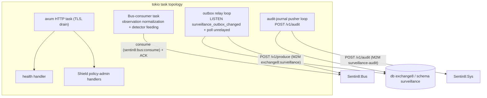

### Request family: detection (observation → alert → case)

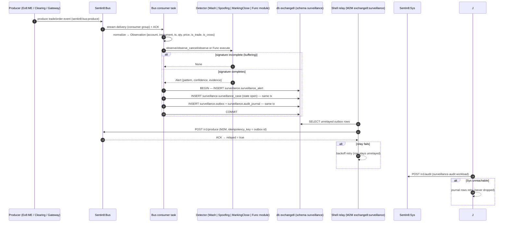

### Request family: case workflow (compliance review)

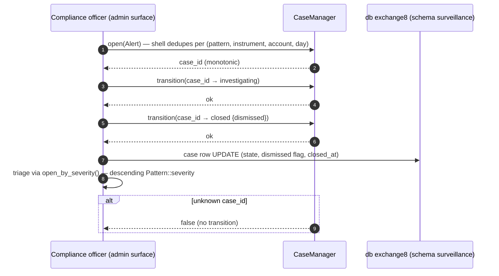

### Request family: operational alert ack

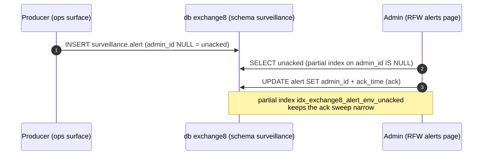

## 3. Data Model

Schema-per-service: database `exchange8`, schema `surveillance`, role
`exchange8_surveillance_service`, DSN env `EXCHANGE8_SURVEILLANCE_DATABASE_URL`.
RLS (`ENABLE` + `FORCE`) on every table; policies require
`sentin8_context_initialized()` and `env_id = sentin8_current_env_id()`
(set via `SELECT sentin8_set_tenant_context(...)` on the same connection).
No cross-schema grants; `cross_schema_grants: []` in registration.

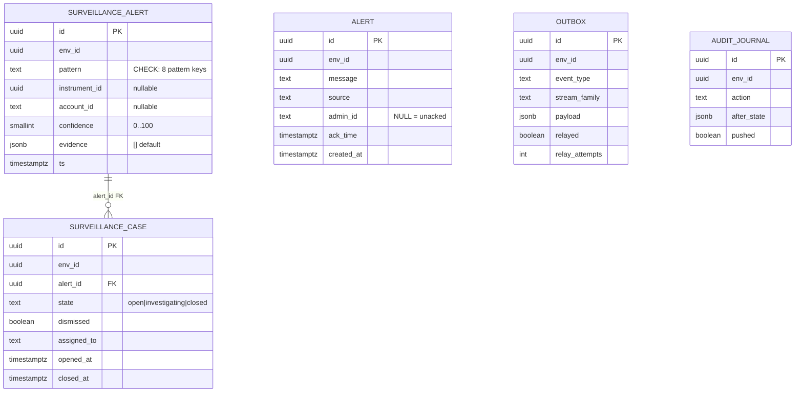

Per-table notes:

| Table | Visibility | Notes |
|---|---|---|
| `surveillance.surveillance_alert` | env-scoped, RLS FORCE | pattern ∈ {wash_trade, spoofing, layering, momentum_ignition, insider_trading, front_running, marking_the_close, excessive_crossing}; confidence CHECK 0–100; index `(env_id, pattern)` |
| `surveillance.surveillance_case` | env-scoped, RLS FORCE | FK to `surveillance_alert(id)`; state CHECK open/investigating/closed; index `(env_id, state)` for the queue view |
| `surveillance.alert` | env-scoped, RLS FORCE | ops alert log; unacked = `admin_id IS NULL`; partial index `(env_id) WHERE admin_id IS NULL` |
| `surveillance.outbox` | env-scoped, RLS FORCE | DBX §6.7 producer table; partial index on `relayed = false`; `pg_notify('surveillance_outbox_changed')` trigger |
| `surveillance.audit_journal` | env-scoped, RLS FORCE | DBX §6.8 journal; partial index on `pushed = false` |

### Lifecycles

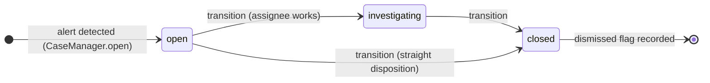

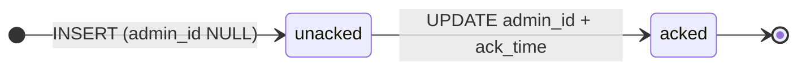

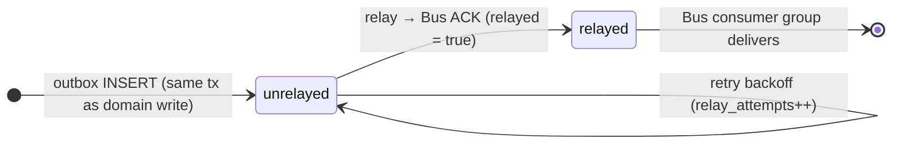

## 4. API Surface

Grouped by audience; the authorization gate for all handler surfaces is the
8-step platform pipeline — bearer verify → tenant resolve → feature gate →
**Shield (`exchange8:surveillance-policy` scope-mirror, enforced)** → RLS
context → execute → audit. The HTTP router mounts health, `/openapi.json` and
the Shield policy-admin API only; domain work arrives via bus events and
(Sentin8:Func-triggered) detections. The single action the step-5 gate
evaluates today is `exchange8:surveillance:alert` (tests/policy.rs
`HANDLER_ACTIONS`).

| Audience | Surface | Gate | Emits |
|---|---|---|---|
| System (M2M) | Detection consume (`exchange8:surveillance:alert` action) | scope-mirror permit / `sentin8:sys` admin scopes | outbox event (see §10) |
| System (M2M) | Bus produce/consume workloads `exchange8:surveillance` (+ `surveillance` short spelling) | `sentin8:bus:produce` / `sentin8:bus:consume` scopes | — |
| System (M2M) | Policy hot-reload + stat workloads `exchange8:surveillance-policy` / `surveillance-policy` | `sentin8:bus:consume` / `sentin8:stat:measure` scopes | — |
| System (M2M) | Audit journal pusher workload `surveillance-audit` | `sentin8:sys:audit:write` scope | — |
| System (M2M) | TLS host-context resolver workload `exchange8-surveillance-tls` | `sentin8:sys:instances:read` scope (`GET /v1/resolve/hostname`) | — |
| Admin (RFW) | `/v1/admin/ui/alerts` + `/v1/admin/alerts` (route `alerts`, label `Alerts`, icon `0xe8d2`) | `exchange8:surveillance:read` / role `exchange8:admin` | — |
| Admin (RFW) | `/v1/admin/ui/cases` + `/v1/admin/cases` (route `cases`, label `Cases`, icon `0xe8a0`) | `exchange8:surveillance:read` / `:write` / role `exchange8:admin` | — |
| Admin | Shield policy-admin API (`exchange8:surveillance:policy:read` / `:write`) | role `exchange8:surveillance:admin` | `sentin8:sys:policy` family |
| Ops | `GET /v1/health`, `/openapi.json` | unauthenticated (health), none | — |

Declared scopes: `exchange8:surveillance:read` / `exchange8:surveillance:write`
/ `exchange8:alert:read` / `exchange8:alert:ack` (admin-role grants under
`exchange8:admin`). Declared error codes: `exchange8_case_not_found` (404).

**Detection-to-case chain (outbox → Bus → trigger):**

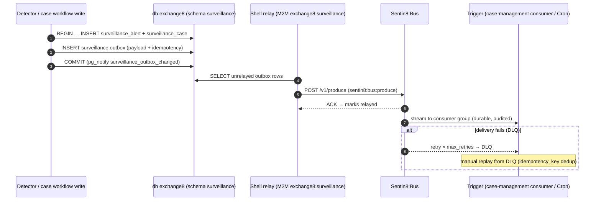

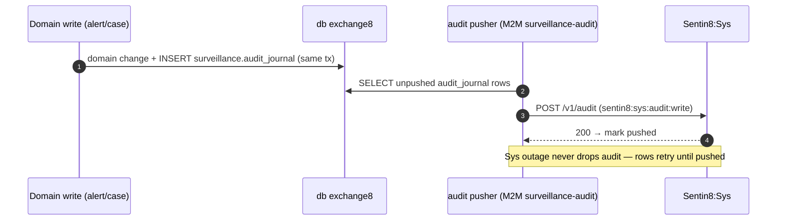

## 5. Cross-Cutting Concerns

- **Authentication** — Sentin8:Auth is the only issuer. Detection work is
  system-driven: cert-bound M2M `client_credentials` tokens (DCR-registered
  per workload: `exchange8:surveillance`, `exchange8:surveillance-policy`,
  `surveillance-policy`, `surveillance-audit`,
  `exchange8-surveillance-tls`). DCR is fail-closed: only workloads present
  in `sentin8_service_workloads` (seeded by `sentin8-cli vertical enroll`)
  can register.
- **Authorization** — the scope-mirror policy set (`origin='platform'`,
  `mode='enforced'`) permits the declared action
  (`exchange8:surveillance:alert`) for callers holding the matching scope or
  the platform-admin scopes (`sentin8:sys:admin`, `sentin8:sys:org:admin`,
  `sentin8:sys:env:admin`). No-set → deny (fail-closed); shadow is an
  emergency rollback lever only; `token_tp` never bypasses policy
  (tests/policy.rs proves all of these against the real seeded text).
- **Tenant resolution + RLS** — every table has `ENABLE` + `FORCE ROW LEVEL
  SECURITY` with policies `sentin8_context_initialized() AND env_id =
  sentin8_current_env_id()`; the context is set with
  `SELECT sentin8_set_tenant_context(...)` (`set_config(..., true)`,
  transaction-local) on the **same connection** as the data statements —
  the async helper must be awaited or RLS silently sees no context. Explicit
  `env_id = $N` predicates remain the primary defense; RLS is the backstop.
  Role `exchange8_surveillance_service` carries no `BYPASSRLS`.
- **Shield as the engine's only name** — the embedded declarative policy
  engine (`sentin8-policy`) is branded Shield in docs, comments and UI; the
  vendor name appears only in the dependency mapping.
- **Idempotency** — case opening dedupes per (pattern, instrument, account,
  day) in the shell consumer; bus produce rides `idempotency_key` = outbox
  row id; detector buffers fire-once-per-signature (spoofing clears its
  buffer on fire) so replays do not duplicate alerts.
- **Rate limiting / bot protection** — ingress tier is the platform edge
  (Sentin8:Proxy); service-local rate policies ride the Shield policy
  surface (per-tenant sets), not bespoke code.
- **Audit journaling** — every state transition writes
  `surveillance.audit_journal` (same transaction where possible); the
  pusher drains to `POST /v1/audit`; Sys outage retries without loss.
- **Drain** — `sentin8::shell` graceful drain on upgrade: HTTP stops
  accepting, in-flight requests finish, the relay/journal pusher checkpoint
  unrelayed/unpushed rows, and Sentin8:Captain's `upgrade-instance` swaps
  the binary (rolling, zero-downtime).
- **TLS** — terminated in-process by `sentin8-tls` behind Sentin8:Proxy
  (single ingress, SNI `exchange8-surveillance.sys.ops…`); the
  `exchange8-surveillance-tls` workload resolves host context DB-free via
  `GET /v1/resolve/hostname` (`sentin8:sys:instances:read`).
  Post-quantum only; no classical fallback.
- **Allocator** — mimalloc global allocator covers HTTP, bus-consumer,
  relay, journal pusher and future purge workers alike.

## 6. Failure Modes & Recovery

### Detector/consumer retry after a detection failure

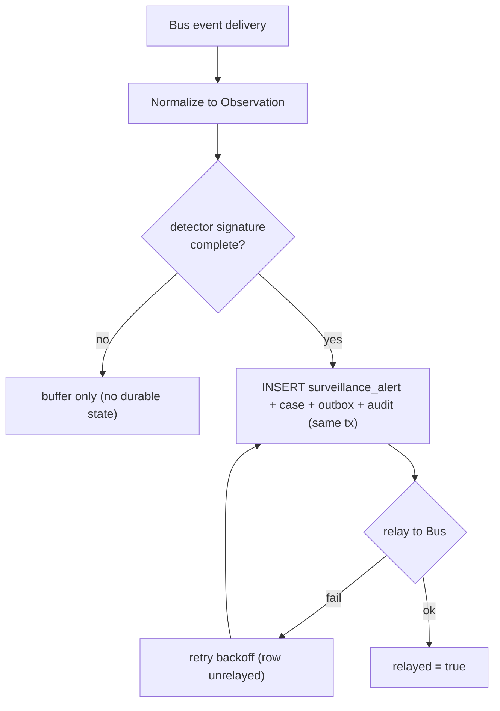

### Relay / journal retry and DLQ

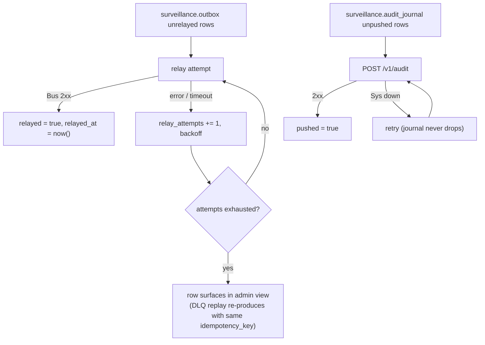

Recovery sequence (crash between write and relay):

```mermaid
sequenceDiagram
    autonumber
    participant W as Detection write
    participant DB as db exchange8
    participant R as Relay (next boot / retry loop)

    W->>DB: BEGIN — alert + case + outbox + audit rows
    W->>W: CRASH before relay (tx COMMITTED)
    Note over DB: alert/case UNIQUE intact; outbox unrelayed; audit unpushed
    R->>DB: boot: SELECT unrelayed outbox
    R->>DB: POST /v1/produce (idempotency_key = row id)
    Note over R: Bus dedupes → no duplicate consumer work
    R->>DB: relayed = true
    R->>DB: audit pusher drains unpushed journal rows
```

| Failure | Behavior |
|---|---|
| Bus unreachable | outbox rows retry with backoff; `idempotency_key` makes replay safe |
| Detector crash | buffered observations are in-process only; the next observation sequence re-detects (event-driven re-derivation) |
| Case workflow rejects | unknown case_id → transition returns false; declared error `exchange8_case_not_found` (404) surfaces the missing case |
| Sys outage | audit journal retries, never drops |
| Duplicate event delivery | day-bucketed (pattern, instrument, account) dedupe in the shell prevents duplicate cases |

## 7. Concurrency & Performance Model

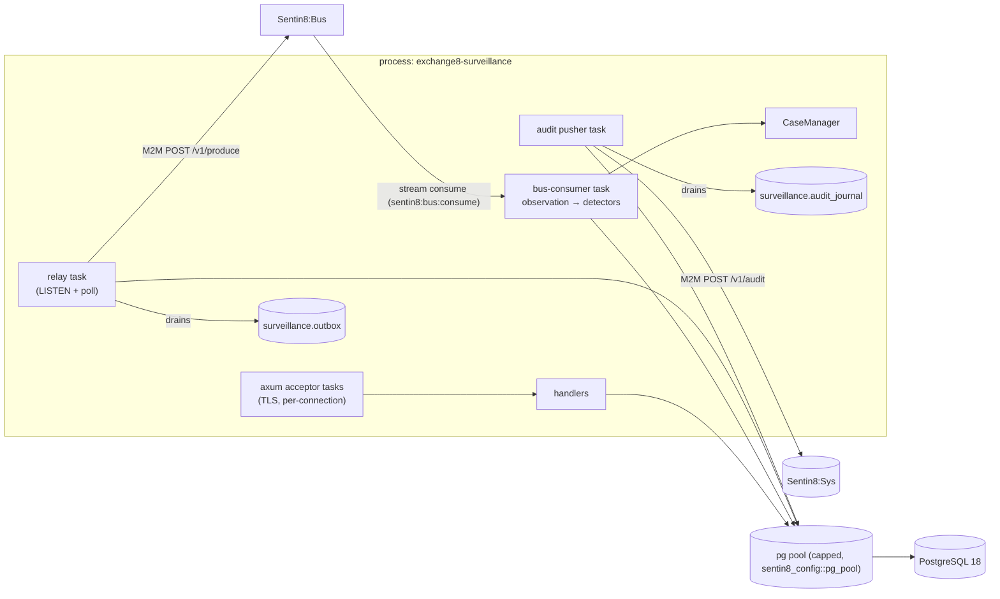

- **Task layout** — one HTTP acceptor; one bus-consumer task (the detector
  driver); one relay task (LISTEN `surveillance_outbox_changed` + periodic
  unrelayed poll); one audit pusher. Detector state is owned exclusively by
  the consumer task (single writer per (account, instrument) buffers) — no
  cross-task shared mutable state, no mutex contention on the observation
  path.
- **Pool sizing** — the shared `sentin8_config::pg_pool::connect` caps
  connections (default 3, overridable) so ~20 services cannot exhaust
  PostgreSQL. Relay and journal use the same pool; context is set
  transaction-locally per statement set.
- **Hot paths & caches** — detector bookkeeping is pure HashMap math
  (per-(account, instrument) counters/buffers); only the completed signature
  touches the DB. The only cache beyond that is the Shield policy set
  (hot-reload consumer keeps loaded sets fresh).
- **Backpressure** — outbox partial index bounds the relay scan; unrelayed
  rows retry with backoff so a Bus outage does not spin; the drain path
  checkpoints before shutdown. The consumer task applies natural backpressure
  by processing the stream sequentially — detectors are cheap (O(1)
  counters, O(burst) buffers) so the normalization step is the pace-setter.

## 8. Invariants, Insecure-Defaults Rejected, Unsafe Rationale

Invariants (always true):

1. A detection's alert row and its case row are created together; a case
   always references an existing alert (FK
   `surveillance_case.alert_id → surveillance_alert.id`).
2. A domain write and its `surveillance.outbox` (and wherever possible
   `surveillance.audit_journal`) row are committed in the **same**
   transaction.
3. Case ids are monotonic (1, 2, 3 …) per manager instance; transitions
   never resurrect a closed case with a new id.
4. A detector fires exactly once per completed signature — the spoofing
   buffer clears on fire, the wash counter counts past its threshold, and
   the close detector depends on per-instrument medians (missing/zero
   median ⇒ no alert, never division by a degenerate basis).
5. Confidence is always within 0–100 (DB CHECK mirrors the core's
   computation).
6. Tenant context and data statements always run on the same connection;
   `sentin8_set_tenant_context` is awaited.
7. The scope-mirror never covers an action absent from the registration —
   `declared_mirror_covers_every_handler_action` fails the build otherwise.
8. No plaintext credentials; no role carries `BYPASSRLS`; the pattern key
   set in SQL (CHECK) and in the core (`Pattern::key`) stays identical.

Insecure defaults rejected:

- **Alerting on a single observation** — every built-in detector requires the
  pattern's abuse signature (repeated self-crosses, a buffered cancel burst,
  an outsized close-window notional); a one-off cross is not a wash trade.
- **`danger_accept_invalid_certs` / hand-rolled CA loading** — TLS is
  in-process via `sentin8-tls` (post-quantum, root CA in the OS trust
  store).
- **Direct cross-schema/table joins into other services** — cross-service
  data flows are membus/bus/owner-API per the access-order rule (this
  service declares zero cross-schema grants today).
- **Static superuser service DSN** — the service role is unprivileged,
  non-bypass, database-`exchange8`-only.
- **Hardwired tenant detection rules** — tenant rules ride Sentin8:Func
  modules and declarative triggers, never platform code.
- **Severity as a mutable per-alert score** — triage ordering would become
  gameable; severity is a `Pattern` constant.

No `unsafe` blocks exist in this service; the unsafe-rationale section is
vacuously satisfied. Soundness-relevant safety instead rests on the
invariants above (fire-once buffers, same-connection context, CHECK-gated
pattern/confidence columns).

## 9. Testing Strategy

```mermaid
graph TD
    PYRAMID["Test pyramid — exchange8-surveillance"] --> UT["Unit (pure core, src/surveillance.rs tests)"]
    PYRAMID --> PWT["Policy wiring (tests/policy.rs)"]
    PYRAMID --> SQL["SQL matrix (tests/sql_matrix.rs, live DB)"]
    PYRAMID --> E2E["Vertical E2E (e2e-ts/, UI + BFF only)"]
    UT --> UT1["pattern keys + severity ranking"]
    UT --> UT2["wash trade: threshold fires once, per (account, instrument) independence, non-cross ignore"]
    UT --> UT3["spoofing: cancel-ratio burst, executed-orders in denominator, buffer reset after fire, low-ratio silence"]
    UT --> UT4["marking the close: window bounds inclusive, median guard (missing/zero), outsized-only"]
    UT --> UT5["case workflow: transitions, monotonic ids, triage sort (severity desc, stable ties), closed drop-out"]
    PWT --> P1["no-set deny · shadow never blocks · forbid wins"]
    PWT --> P2["M2M parity · platform-admin scopes · cross-env isolation"]
    PWT --> P3["mirror covers every handler action · enroll dry-run"]
    SQL --> S1["RLS matrix: no context / own env / cross env"]
    SQL --> S2["role existence, non-bypass (DCR check)"]
    E2E --> E1["human-parity flows; no direct SQL/backend"]
```

- **Unit layer** — the pure core owns every detection-semantics assertion:
  the alert-once-per-signature behavior, per-(account, instrument) counter
  independence, cancel-ratio arithmetic (executed orders in the
  denominator, confidence from the ratio), close-window inclusivity and
  median guards, triage ordering with stable same-severity ties, and case-id
  monotonicity.
- **Policy layer** — proves the *real* seeded scope-mirror text evaluates
  fail-closed, respects mode and origin, isolates sets per `env_id`, keeps
  M2M parity, and dry-runs clean at enroll.
- **SQL matrix** — live PostgreSQL via the non-bypass `exchange8_probe`
  role: policy coverage derived from this service's own `init.sql` (every
  declared table is FORCE-RLS'd with a select policy), plus the behavioral
  RLS matrix (no context → 0 rows, insert rejected, own env → exact probe
  row, cross env → 0 rows) over one rolled-back transaction. Skips silently
  when the DB is unreachable so test runs stay hermetic.
- **Deliberately not tested here** — platform TLS/RLS plumbing itself,
  Sentin8:Bus delivery guarantees, Shield engine internals: covered by the
  platform's own test strategy docs.
- **E2E** — the vertical's `e2e-ts` suite drives the real UI through BFF
  only (no direct SQL), so surveillance surfaces are exercised as a human
  would.

## 10. Open Questions

- The RFW admin pages (`alerts`, `cases`) are registered but their data/UI
  handlers are not mounted in this binary — wiring the admin surface for
  these resources is outstanding.
- Observation sourcing (the bus consumer that produces `Observation`s from
  the trade/order event stream, consumer-group configuration, and the
  day-bucketed duplicate-alert dedupe it must implement) is designed but not
  yet wired; `event_triggers` in registration is an empty list today.
- Outbox event emission from the case workflow (event types, stream
  families, trigger registrations) is designed by the DBX pattern but not
  yet wired into handlers.
- The `surveillance.alert` operational-alert producers and the admin ack
  flow are not implemented beyond the table.
- The remaining built-in detectors (layering, momentum ignition, insider,
  front-running, excessive crossing) land via tenant rules today; promoting
  any of them into the pure core is a rule-library decision pending
  cross-book context availability.
- Alert-to-case dedupe window and case re-open semantics (a dismissed case
  re-opening on a follow-up detection) are compliance-process decisions not
  yet modeled.

---

**Design attribution:** exchange8:surveillance and its underlying concepts were designed by Hamid Jahanzad <Hamid@Jahanzad.com>.
