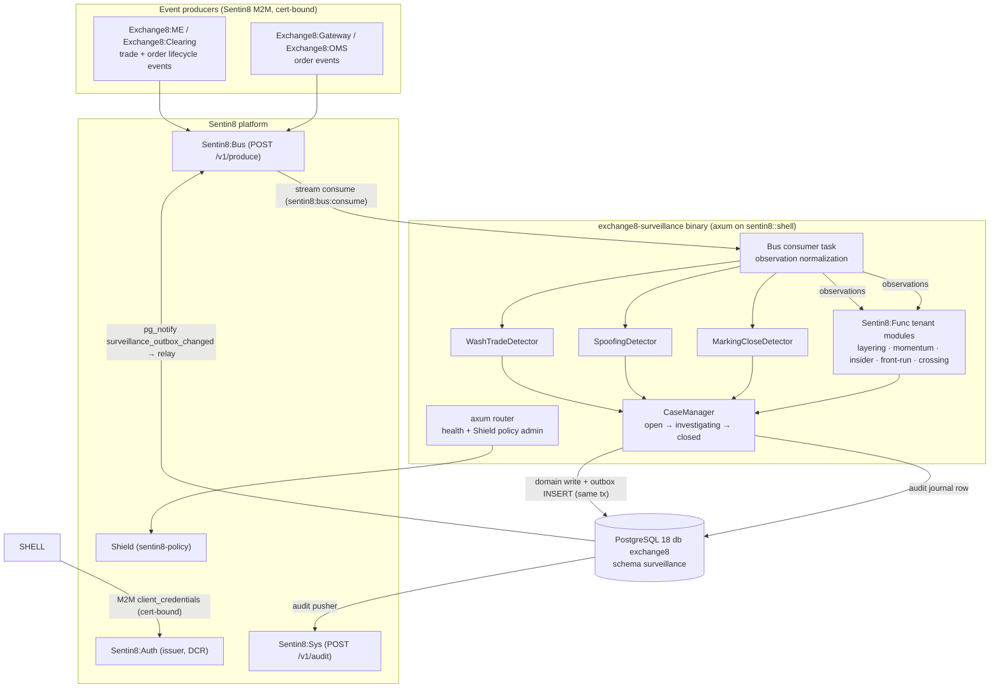

# Exchange8:Surveillance

## 1. Summary

Exchange8:Surveillance is the **market-surveillance** service of the exchange8
vertical - the compliance tier that detects market-abuse patterns in the
trade/order event stream and turns detections into reviewable cases. It
implements the eight regulatory detection patterns (wash trade, spoofing,
layering, momentum ignition, insider-like trading, front-running, marking the
close, excessive crossing) as pure, deterministic detectors over a normalized
observation stream, plus the case-management workflow (open → investigating →
closed) that compliance staff drive from the admin surface, and the
unacknowledged operational-alert queue for the venue's alert log. It is a Rust
axum binary built on the platform `sentin8::shell` crate (Sentin8 Shell):
graceful drain.

The detection core is a pure Rust library (`services/surveillance/src/surveillance.rs`):
no clock, no I/O, no database dependency on the observation path. The shell
wires persistence via the platform planes - a local `surveillance.outbox`
relayed to Sentin8:Bus, an `surveillance.audit_journal` pushed to Sentin8:Sys,
and RLS-forced tenant tables in schema `surveillance` of database `exchange8`.

## 2. Motivation

- **Market-abuse detection is a regulatory obligation** (MAR / MiFID II): a
  venue must be able to demonstrate, per instrument and per account, that
  manipulative patterns are watched and that every alert was dispositioned.
  The detection core therefore exists as testable, deterministic code - the
  same observations always produce the same alerts.
- **Alerts without workflow are noise.** A detection that cannot be assigned,
  investigated, and closed with a dismissal record does not satisfy a
  compliance program. The case state machine and triage view make each alert
  an auditable work item.
- **Not every alert is abuse - thresholds matter.** A single accidental
  self-cross is not a wash trade; a balanced trader with some cancels is not
  a spoofer. Each detector implements its pattern's signature (repeated
  self-crossing, cancel-ratio bursts, outsized close-window notionals) so
  ordinary trading passes and only the abuse signature alerts.
- **Severity-ranked triage.** Insider-like trading and front-running rank
  above spoofing-family patterns, which rank above close-window and
  self-crossing volume; the compliance desk works the highest-severity open
  cases first.
- **Tenant-authored detection rules.** The venue's own rule library is
  expressed as tenant-authored Sentin8:Func modules over the same
  observation contract; the platform ships the detection framework and the
  built-in wash/spoofing/marking-the-close core, not hardcoded tenant rules.
- **No bespoke infrastructure.** Identity, TLS, policy administration, event
  durability, and audit delivery are platform services (Sentin8:Auth,
  `sentin8-tls`, Shield, Sentin8:Bus, Sentin8:Sys); the binary owns only the
  surveillance domain.

## 3. Architecture & High-Level Design

The service is a Sentin8 Shell binary. The binary wires the HTTP/TLS surface
(health, `/openapi.json`, the Shield policy-admin API) and the platform data
paths; the domain logic lives in the pure-core sibling module the shell
drives:

| Module | Responsibility |
|---|---|
| `surveillance.rs` | The eight `Pattern`s with regulatory severity ranking; the `Observation` event contract; the wash-trade, spoofing and marking-the-close detectors; the `CaseManager` workflow (open/investigating/closed) and severity triage |
| `registration.rs` | Self-registration: Shield (sentin8-policy) policy set, PG role, admin scopes, error codes, RFW admin pages, M2M DCR grants, SQL init migration |

Persistence follows the platform DBX pattern: **every domain write inserts a
`surveillance.outbox` row in the same transaction**; the shell relay pushes it
to Sentin8:Bus `POST /v1/produce` (`idempotency_key` = outbox row id), and the
audit pusher drains `surveillance.audit_journal` to Sentin8:Sys
`POST /v1/audit` (`sentin8:sys:audit:write`).

## 4. Key Traits and Data Structures

Pure core; concepts, not pasted signatures:

- **`Pattern` (the detection vocabulary)** - the eight regulated market-abuse
  patterns, each with a stable string key (`wash_trade`, `spoofing`,
  `layering`, `momentum_ignition`, `insider_trading`, `front_running`,
  `marking_the_close`, `excessive_crossing`) that doubles as the
  `surveillance.surveillance_alert.pattern` row value, and a regulatory
  **severity rank** used for triage: insider-trading/front-running 4, the
  spoofing family (wash/layering/momentum/spoofing) 3, close-window and
  crossing 2.
- **`Observation` (the normalized event)** - one account-anchored event:
  beneficial-owner account, instrument, microsecond timestamp, quantity,
  raw fixed-point price, side, and the two classification flags that drive
  every detector (`is_trade`, `is_cross`). Crosses are both-sides-same-owner
  executions; the beneficial-owner pairing is what makes the wash-trade
  signature derivable from a single record.
- **`Alert` (the detection output)** - pattern + instrument + account +
  confidence (0-100) + the supporting observations as evidence for the case
  file. Alert-to-case linkage is one alert → one case: `CaseManager.open`
  wraps the alert verbatim in a `Case` (case_id, alert, state), so the case
  file always carries the detection that opened it.
- **Detach-then-alert idiom** - a stateful detector buffers observations per
  (account, instrument) and fires an alert exactly once when the signature
  completes, then either resets or falls silent for further increments (the
  spoofing buffer clears on fire; the wash counter counts past its
  threshold), so a replayed sequence cannot produce duplicate alerts.
- **`CaseManager` and `CaseState`** - the case workflow: `open` hands out
  monotonically increasing case ids, `transition` moves a case through
  `open → investigating → closed` (the closed case records `dismissed`),
  and `open_by_severity` is the triage view - open cases sorted by descending
  pattern severity, stable for same-severity insertion order.

## 5. Rationale, Trade-offs, and Alternatives

- **Pure, deterministic detectors.** Detectors are plain structs over an
  observation stream: no tokio, no DB, no wall clock (timestamps ride the
  `Observation`). The same observation sequence replays to the same alerts -
  a compliance defensibility requirement, and what makes the unit-test suite
  an exact specification of each pattern's signature. Rejected alternative:
  windowed streaming over platform time - non-deterministic under reordering
  and replay.
- **Severity as a per-pattern constant.** Triage ranking is a property of the
  pattern class, not a per-alert score: insider-like and front-running outrank
  the spoofing family because they imply knowledge asymmetry, while
  close-window volume and self-crossing are market-quality concerns.
  Confidence remains per-alert (computed from the evidence ratio for
  spoofing; fixed signatures otherwise).
- **Built-in core for the three data-derivable patterns.** Wash trade,
  spoofing and marking-the-close are fully derivable from the observation
  stream (sides, cancels, close-window notionals) - keeping them in the core
  makes the venue's baseline rule set enforceable and auditable without any
  tenant configuration. The remaining five patterns (layering, momentum,
  insider, front-running, excessive crossing) depend on cross-book context,
  news timing or client-order knowledge that the platform does not
  warehouse; they ride tenant-authored event rules (Sentin8:Func modules)
  constructing the same `Pattern`/`Alert` contract. A hardwired tenant rule
  set was rejected: it would ship one platform's compliance program to all.
- **Alerts-as-evidence.** Each `Alert` embeds its supporting `Observation`s;
  the case file (the SQL row's `evidence` JSONB) is therefore
  self-contained - a reviewer never re-derives the detection from raw event
  archaeology. The cost is row size on multi-observation detections (the
  spoofing burst), accepted because an alert is written once.
- **Case management in the same service.** The alert producer and the case
  workflow share the pattern vocabulary and evidence shape; splitting case
  management into another service would add an API tier for data that is one
  row hop apart (`surveillance_case.alert_id → surveillance_alert.id`).
  Regulatory report generation is NOT here - it stays with Exchange8:Regulatory,
  which consumes closed cases.

## 6. Unresolved Questions / Future Designs

- The HTTP surface today carries health, `/openapi.json` and the Shield
  policy-admin API; the RFW admin pages declared in registration (`alerts`,
  `cases`) do not yet have mounted data/UI handlers in this binary.
- Observation sourcing (the Sentin8:Bus subscription/consumer-group wiring
  that produces `Observation`s from `exchange8:...:trade/order` events),
  outbox event emission from the case workflow, and the declarative event
  triggers (Sentin8:Func module bindings) in `vertical-registry.json` are
  designed but not yet wired - `event_triggers` is an empty registration
  list today.
- The `surveillance.alert` operational-alert ingest path (which producer
  surfaces write the venue's alert log, and the admin ack flow) is not yet
  implemented beyond the table.
- Remaining built-in detectors for layering, momentum ignition, insider-like
  trading, front-running and excessive crossing (they are declared in the
  pattern vocabulary and currently land via tenant-authored rules).
- Day-bucketed alert dedup (the shell's (pattern, instrument, account, day)
  dedupe contract referenced by the case manager) and case persistence
  wiring (`CaseManager` state → `surveillance.surveillance_case` rows) are
  open until the consumer task lands.

---

**Design attribution:** exchange8:surveillance and its underlying concepts were designed by Hamid Jahanzad <Hamid@Jahanzad.com>.
